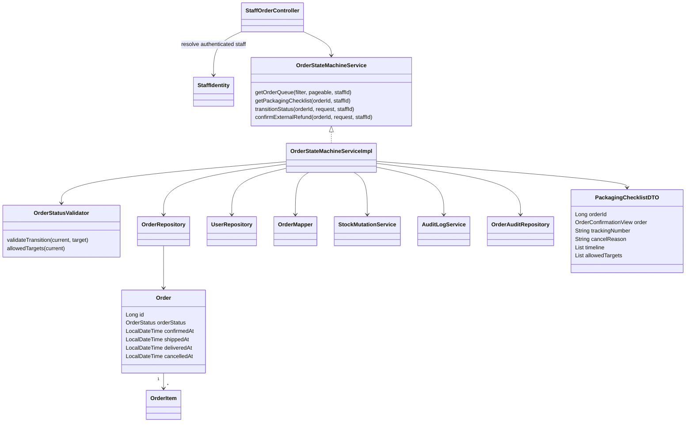

# II.24 — UC14: View Order Queue & Details

Tác giả: Nguyễn Phú Trọng. Phối hợp state machine: Trần Huỳnh Giác.

Đây là nội dung thiết kế để đưa vào SDS Template 3; repository chưa có bản SDS gốc để cập nhật trực tiếp.

## Phạm vi và quyền

- Sale Staff/Admin xem và xử lý hàng đợi tại `/staff/orders`. Manager được xem và hủy đơn đủ điều kiện; không được duyệt/giao/xác nhận hoàn tiền.
- Loại `PENDING_PAYMENT` bằng predicate bắt buộc trước cả lọc/phân trang. Chi tiết và cập nhật trực tiếp đơn ở trạng thái này trả 404.
- Tài khoản phải còn hoạt động và có role hợp lệ tại thời điểm gọi service, không chỉ lúc đăng nhập.
- Không nhận staffId từ form. `StaffIdentity` lấy ID từ principal, service đọc lại tài khoản từ database.
- Hàng đợi phân trang 20 đơn, mặc định ưu tiên ngày đặt tăng dần, ID tăng dần để thứ tự ổn định.
- Lọc kết hợp trạng thái đơn, trạng thái thanh toán, phương thức thanh toán, ngày bắt đầu/kết thúc.
- Khoảng ngày bao gồm toàn bộ ngày kết thúc: `created_at >= fromDate 00:00` và `< toDate + 1 ngày 00:00`.
- Bộ lọc giữ nguyên khi phân trang; khoảng ngày ngược hoặc dữ liệu không hợp lệ trả lỗi 400.

## Class diagram



## Class specification

| Thành phần | Trách nhiệm / hợp đồng |
| --- | --- |
| StaffOrderController | GET hàng đợi; GET phiếu đóng gói; POST transition; validate form, CSRF, phản hồi lỗi |
| StaffIdentity.resolve(authentication) | Trả ID từ local principal, không tin ID do client gửi |
| getOrderQueue(filter, pageable, staffId) | Xác minh role/active, kiểm tra ngày, lọc bằng JPA Specification trước phân trang, trả DTO |
| getPackagingChecklist(orderId, staffId) | Đọc order/items trong transaction, mapping snapshot và các thao tác phù hợp |
| PackagingChecklistDTO | Người nhận, SĐT, địa chỉ lúc đặt; các dòng sản phẩm/SL; trạng thái thanh toán; vận đơn; timeline |
| OrderQueueSpecification | Ghép các điều kiện có giá trị, không ghép chuỗi SQL từ dữ liệu người dùng |
| OrderMapper | Mapping dữ liệu đã lưu, không điều phối nghiệp vụ |

Phiếu có checkbox kiểm hàng và nút in. Dấu kiểm phục vụ đối chiếu tại màn hình/in, chưa lưu thành tiến độ đóng gói trong database. Yêu cầu hiện tại không quy định lưu tiến độ checklist hoặc bắt buộc tích đủ trước khi giao.

# II.25 — UC14.1: Update Order & Payment Status

## State graph

```mermaid
stateDiagram-v2
    PENDING_CONFIRMATION --> CONFIRMED: Staff confirms
    CONFIRMED --> SHIPPING: Hand over to courier
    SHIPPING --> DELIVERED: Successful delivery; COD collection confirmed
    PENDING_CONFIRMATION --> CANCELLED: Reason required
    CONFIRMED --> CANCELLED: Reason required
```



`PENDING_PAYMENT → PENDING_CONFIRMATION` thuộc luồng xác nhận thanh toán, không phải thao tác staff của UC14.1. Không có cạnh nhảy bước, đảo ngược hoặc đi ra từ DELIVERED/CANCELLED. Mọi cặp ngoài graph ném `IllegalStateTransitionException`, kế thừa `AppException`, dùng mã `INVALID_ORDER_STATE_TRANSITION` (409).

## Hợp đồng transitionStatus

Chữ ký triển khai: `transitionStatus(Long orderId, OrderTransitionRequest request, Long staffId)`.

Request gồm `targetStatus`, `reason`, `trackingNumber`, `codCollected`. Gói request giữ nguyên ý nghĩa của `transitionStatus(orderId, targetStatus, staffId)` trong backlog và thêm lý do hủy/mã vận đơn/xác nhận thu COD.

1. Xác minh người thao tác đang hoạt động. Manager chỉ được chọn CANCELLED; Sale Staff/Admin có các thao tác xử lý phù hợp.
2. Validate request; trạng thái đích bắt buộc; lý do tối đa 255 ký tự; vận đơn tối đa 100 ký tự.
3. Đọc order bằng `findByIdWithLock` (`@Lock(PESSIMISTIC_WRITE)`), không tồn tại trả 404. `refresh(PESSIMISTIC_WRITE)` nạp lại dữ liệu mới nhất nếu entity đã có trong persistence context. Giữ khóa đến hết transaction.
4. `OrderStatusValidator.validateTransition(current, target)` kiểm tra cạnh hợp lệ.
5. Với CONFIRMED/SHIPPING/DELIVERED: VNPay phải PAID, COD phải UNPAID; đơn đã trừ kho, chưa hoàn kho. Ghi mốc tương ứng `confirmed_at`, `shipped_at`, `delivered_at`. Khi SHIPPING có thể ghi mã vận đơn. DELIVERED của COD bắt buộc `codCollected=true` và ghi PAID cùng transaction.
6. Với CANCELLED: lý do không được trống; không đã giao, đã nhận, hoàn kho hoặc REFUNDED. VNPay UNPAID luôn cần đối soát, kể cả thiếu txnRef. Lưu lý do, gọi `restoreCancelledOrder(orderId, staffId)` trong cùng transaction đã giữ khóa đơn.
7. Flush cập nhật. Ghi audit bắt buộc `ORDER_STATUS_CHANGED`: actor, order, trạng thái đơn/thanh toán trước/sau, lý do, vận đơn và xác nhận thu COD.
8. Toàn bộ thao tác trong transaction. Lỗi hoàn kho, không lấy được khóa, serialize hoặc ghi audit đều rollback trạng thái, mốc thời gian, số lượng kho và audit.

Engine kho hiện có chịu trách nhiệm `cancelled_at`, marker hoàn kho và audit `ORDER_CANCELLED_RESTOCK`. Marker ngăn hoàn kho lặp. UC14.1 yêu cầu đơn đã được trừ kho lúc đặt theo PRE-3; engine vẫn giữ hành vi riêng cho chứng từ chưa trừ tồn ở các luồng khác.

Không trừ kho khi xác nhận hoặc bắt đầu giao: checkout đã trừ tồn một lần. Trạng thái thanh toán độc lập với trạng thái đơn; COD chỉ được chuyển DELIVERED + PAID khi staff xác nhận đã giao và thu đủ tiền. Hủy đơn đã PAID không tự ghi REFUNDED, mà hiển thị Cần hoàn tiền.

## Xác nhận nhận lại hàng hoàn và hoàn kho (POP-DB-02 / UC14.1)

- `POST /staff/orders/{id}/return-restock` chỉ cho Sale Staff/Admin; Manager bị chặn với 403 Forbidden.
- Nhận xác nhận kiểm đếm đầy đủ 100% số lượng (`fullReturnVerified = true`), lý do hoàn hàng (`returnReason`), và ghi chú kiểm hàng thực tế (`inspectionNote`).
- Chỉ áp dụng cho đơn ở trạng thái `SHIPPING` (giao không thành công hoàn kho) hoặc `DELIVERED` (khách trả nguyên đơn) có tồn kho đã trừ (`stock_deducted_at != null`) và chưa từng hoàn tồn (`stock_restored_at == null`).
- Giữ nguyên trạng thái đơn (`SHIPPING` hoặc `DELIVERED`) và trạng thái thanh toán.
- Gọi `StockMutationService.restoreReturnedOrder(orderId, staffId)` để tăng tồn kho an toàn theo thứ tự ID tăng dần, ghi nhận `stock_restored_at`, `stock_restore_reason = 'RETURNED'`, `stock_restored_by_user_id = staffId`, và ghi audit `ORDER_RETURN_CONFIRMED`.
- Ghi audit bổ sung `ORDER_RETURN_INSPECTION_CONFIRMED` lưu lý do và ghi chú kiểm đếm.
- Theo Baseline V2.4, UC24 đã được loại bỏ hoàn toàn; việc tiếp nhận và hoàn kho hàng trả được xử lý trực tiếp tại màn hình đóng gói & xử lý đơn (UC14.1).

## Xác nhận hoàn tiền bên ngoài hệ thống (14.1.4)

- `POST /staff/orders/{id}/refund` chỉ cho Sale Staff/Admin; Manager bị chặn tại controller và service.
- Nhận số tiền, phương thức, ngày hoàn tất, thông tin chứng minh, và xác nhận đã thực sự hoàn tiền.
- Giữ `PESSIMISTIC_WRITE` trên order, refresh dữ liệu, kiểm tra payment PAID và cơ sở: đơn CANCELLED hoặc đơn RETURNED có marker trả hàng thành công (`stock_restore_reason=RETURNED`, thời điểm và người xác nhận đã lưu).
- Căn cứ hoàn tiền cho hàng trả dựa trên việc xác nhận nhận lại toàn bộ hàng hoàn thực tế (POP-DB-02); hoàn tiền tách biệt với hoàn kho và không cộng lại tồn kho lần nữa.
- Đọc ledger để chặn xác nhận trùng. Chỉ hỗ trợ hoàn toàn bộ `final_total_amount`; từ chối số tiền nhỏ hơn/lớn hơn, thiếu chứng từ hoặc ngày tương lai.
- Cập nhật payment REFUNDED và append `ORDER_REFUND_CONFIRMED` trong cùng transaction. Giữ nguyên order status và stock. Hai staff cùng hoàn chỉ một xác nhận thành công.
- Refund ledger dùng `audit_logs.details_json` hiện có, gồm amount, method, completedDate, supportingInfo và basis; actor/time dùng các cột audit sẵn có. Không thêm cột/bảng database.
- `AuditLogService.recordRequired` không nuốt lỗi persistence: ghi ledger thất bại phải rollback cập nhật nghiệp vụ. Hàm `record` giữ nguyên hành vi ghi log best effort cho các luồng cũ.
- `OrderAuditRepository` chỉ đọc lịch sử đơn và xác nhận hoàn; không cung cấp UPDATE/DELETE.
- Chi tiết hiển thị lịch sử actor/time và thông tin vận hành đã chọn, không xuất toàn bộ raw audit JSON. Lỗi chuyển bước trả 409 cùng chi tiết mới nhất; lỗi đọc dữ liệu trả lỗi riêng, không giả thành hàng đợi rỗng.

## Sequence diagram — duyệt và hủy đơn

```mermaid
sequenceDiagram
    actor Staff
    participant UI as Packaging Checklist
    participant C as StaffOrderController
    participant S as OrderStateMachineService
    participant V as OrderStatusValidator
    participant DB as OrderRepository / MySQL
    participant Stock as StockMutationService
    participant Audit as AuditLogService
    Staff->>C: GET /staff/orders/{id}
    C->>S: getPackagingChecklist(id, authenticatedStaffId)
    S->>DB: Read order/items
    S-->>UI: Snapshots + allowed targets
    Staff->>C: POST target + reason/tracking + CSRF
    C->>S: transitionStatus(id, request, authenticatedStaffId)
    Note over S,Audit: One database transaction
    S->>DB: SELECT FOR UPDATE; refresh latest state under lock
    S->>V: validateTransition(current, target)
    alt Invalid transition
        V-->>C: IllegalStateTransitionException (409)
    else Normal progression
        S->>DB: Update state/timestamp while holding order lock
    else Cancellation
        S->>DB: Validate reason under order lock
        S->>Stock: restoreCancelledOrder(id, staffId)
        Stock->>DB: Lock order/products; restore once; stamp metadata
        Stock->>Audit: ORDER_CANCELLED_RESTOCK if stock restored
    end
    S->>DB: Flush changes while holding order lock
    S->>Audit: ORDER_STATUS_CHANGED
    alt Conflict or persistence/audit failure
        DB-->>S: Exception
        Note over S,Audit: Roll back all changes
        S-->>C: Error; conflict returns 409
    else Success
        S-->>C: Commit
        C-->>UI: Redirect to refreshed checklist
    end
```

## Database queries

SQL sau minh họa SQL do JPA/engine sinh ra; tên cột trạng thái thực tế là `order_status`.

```sql
-- Queue predicates are included only when filters are provided.
SELECT o.* FROM orders o
WHERE o.order_status = :status AND o.payment_status = :paymentStatus
  AND o.payment_method = :paymentMethod
  AND o.created_at >= :fromInclusive AND o.created_at < :toExclusive
ORDER BY o.created_at ASC, o.id ASC LIMIT :size OFFSET :offset;

SELECT COUNT(*) FROM orders o WHERE /* same optional predicates */ 1=1;
SELECT * FROM order_items WHERE order_id = :orderId;

-- Acquire the order lock before state validation; keep it through commit/rollback.
SELECT * FROM orders WHERE id = :id FOR UPDATE;
UPDATE orders SET order_status = 'CONFIRMED', confirmed_at = :now WHERE id = :id;

-- Cancellation delegates inventory operations to the existing stock engine.
SELECT * FROM orders WHERE id = :id FOR UPDATE;
SELECT * FROM products WHERE id IN (:productIds) ORDER BY id FOR UPDATE;
-- The stock engine updates quantities and posting metadata in the same transaction.

INSERT INTO audit_logs(user_id, action, target_table, target_id, details_json)
VALUES(:staffId, 'ORDER_STATUS_CHANGED', 'orders', :orderId, :detailsJson);
```

## Pessimistic locking và schema

Không có `@Version` hoặc trường phiên bản trên entity/form. Service lấy khóa `PESSIMISTIC_WRITE` trên đơn trước khi kiểm tra trạng thái. Khóa chỉ giải phóng khi transaction commit/rollback, bao gồm thời gian hoàn kho và ghi audit. Đơn khác vẫn có thể được xử lý độc lập.

Hai nhân viên cùng gửi CONFIRMED: người đầu cập nhật và commit; người sau chờ khóa rồi đọc CONFIRMED, nên cạnh CONFIRMED → CONFIRMED bị từ chối bằng `IllegalStateTransitionException` (409). Chỉ có một lần ghi audit. Không so sánh với dữ liệu trên form; yêu cầu được đánh giá theo trạng thái database tại lúc lấy khóa.

- `refresh(PESSIMISTIC_WRITE)` cần thiết vì query có khóa không tự thay thế dữ liệu entity đã cache trong persistence context.
- Engine `deductOrder` tiếp tục đọc/refresh có khóa trước kiểm tra marker để giữ tính replay an toàn của checkout.
- Không cần thêm cột hoặc chạy migration cho UC14.1; đã bỏ file migration cột phiên bản.
- Không lấy được khóa, timeout hoặc deadlock trả conflict (409), yêu cầu tải lại và thử lại.
- Các luồng cập nhật trạng thái sau này cũng phải lấy khóa đơn và kiểm tra lại trạng thái trong cùng transaction để giữ đúng state machine.

## Kiểm thử và bằng chứng

- `OrderStateMachineServiceTest`: toàn bộ 36 cặp trạng thái; mốc thời gian; role; lý do; refresh dữ liệu có khóa trước validate; điều kiện VNPay; audit.
- `StaffOrderControllerTest`: render Thymeleaf thật, filter/paging, snapshot/checklist, CSRF, quyền, ID giả mạo, conflict và form lỗi.
- `OrderPlacementMySqlTest` (các test `staff*`): thực sự commit/rollback trên InnoDB, hoàn kho một lần, audit failure rollback và hai nhân viên duyệt đồng thời.
- MySQL QA chỉ dùng database local tên ngẫu nhiên `uc11_qa_<uuid>`, không dùng database ứng dụng. Test dọn đúng database đã tạo.
- Hướng dẫn sử dụng: `docs/orders/USER_MANUAL.md`.
- Chưa cập nhật bản SDS Word bên ngoài repository hoặc tạo ảnh chụp nghiệm thu từ phiên đăng nhập thật.
