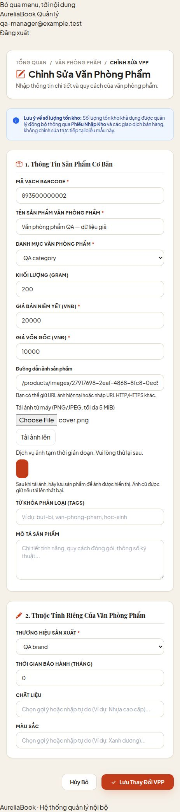
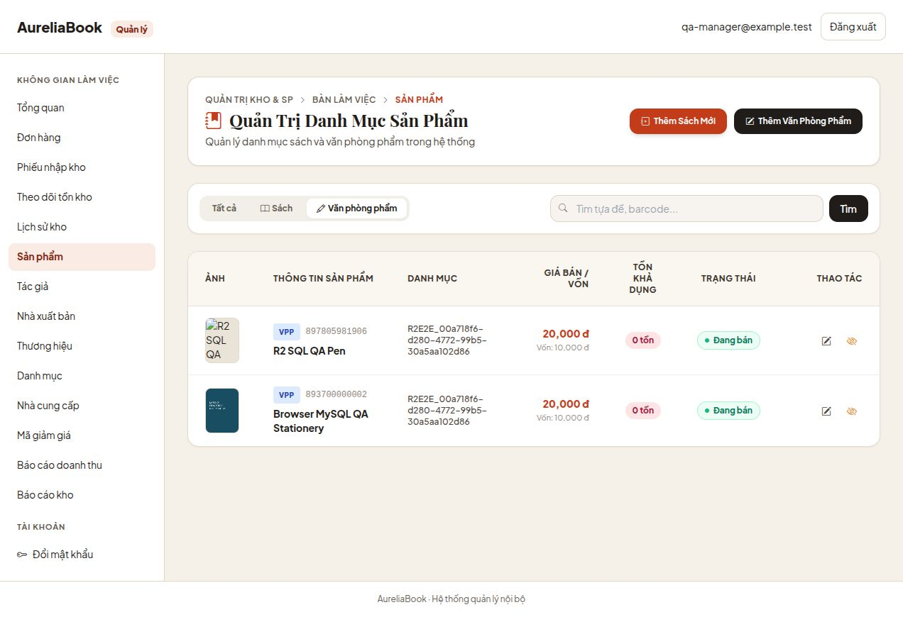

# R2.37.1–R2.37.2 — Release readiness (01/11/2026)

## Kết luận

**R2.37.1 PASS; R2.37.2 PASS trong phạm vi QA local:** browser + real MySQL/JPA/business services + local Nginx, storage và account identities giả lập. Chưa đủ điều kiện deploy hoặc khẳng định live R2 hoạt động. R2.37.3–R2.37.5 chưa thực hiện; không kết nối bucket, mở PR, merge hoặc deploy.

## Phát hiện và thay đổi

| Hạng mục | Trước | Sau | Giới hạn bằng chứng |
|---|---|---|---|
| Hibernate DDL | update | validate mặc định | Không có datasource thật được khởi động; deployment overrides vẫn phải audit |
| JDBC tự tạo DB | createDatabaseIfNotExist=true | Bỏ tham số | Không thay schema hay dữ liệu |
| Multipart | file 5 MiB, request 10 MiB | file 5 MiB, request 6 MiB, disk threshold 0 | Request chunked thật >6 MiB trên QA Tomcat → 413 JSON |
| Upload rate | Chỉ client single-flight | 10 attempts / phút / principal MANAGER / JVM | Fixed window; invalid/failed attempts cũng tính quota |
| Concurrency | Chưa có | Tối đa 2 POST uploads đang xử lý / JVM, không chờ slot | Chạy trước CSRF/multipart parameter parsing; không phải edge DDoS protection |
| Map quota | Chưa có | Tối đa 1024 identities, prune expired, từ chối khi đầy | Không evict live quota để tránh bypass; restart mất quota |
| Backpressure | Chưa có | 429 JSON, Retry-After 60 (quota) / 1 (capacity) | Browser có thông báo 429, không tự retry |
| Pause upload | Chỉ tắt toàn R2 | R2_UPLOAD_ENABLED=false giữ GET/storage, tắt POST controller và ẩn uploader | Restart cần áp dụng env mới; POST bị admission filter trả 503 trước parse |
| SDK timeout | SDK defaults | API call 30s, attempt 10s | Unit tests đọc config thật; chưa đo live network |

`ProductImageUploadFilter` được tạo duy nhất trong internal SecurityFilterChain, trước CsrfFilter, không là servlet Filter bean để tránh chạy hai lần. Không thay role rules hoặc tắt CSRF. Admission không tự cấp quyền; auth/role/CSRF vẫn đi qua chain thật. Không đọc body/parameters trước admission. Anonymous/role khác không tạo quota identity; vẫn chịu concurrency và servlet limits. Không dùng IP hay X-Forwarded-* làm danh tính quota.

Config mới trong Spring process/container:

```text
R2_ENABLED=false                     # default; tắt cả GET/storage/upload
R2_UPLOAD_ENABLED=true               # default, chỉ có tác dụng upload khi R2_ENABLED=true
R2_UPLOAD_REQUESTS_PER_MINUTE=10
R2_UPLOAD_MAX_CONCURRENT=2
```

`R2_UPLOAD_ENABLED=false` không cấm lưu lại URL ảnh đã có hoặc gắn lại một object tồn tại. Đây là pause upload, không phải cửa sổ maintenance khóa toàn bộ product writes.

## Ma trận rollback

| Tình huống | Thao tác đề xuất | Tác động |
|---|---|---|
| Chưa có internal URLs trong DB | Có thể tắt R2 sau khi kiểm kê đúng môi trường | URL ngoài giữ nguyên |
| Đã có internal URLs, upload lỗi/chi phí tăng | Giữ R2_ENABLED=true, đặt R2_UPLOAD_ENABLED=false | Ẩn upload, giữ GET/storage và ảnh cũ nếu DB/R2 healthy |
| DB/R2 outage | Pause upload, phục hồi dịch vụ; GET có thể 503 | Pause không chữa outage và không khôi phục dữ liệu |
| Rollback binary sau khi đã lưu internal URLs | Chỉ dùng bản đã xác minh vẫn hỗ trợ GET path/visibility/schema hiện tại | Không quay về binary trước tính năng R2 mà không có phương án chuyển URL |
| Buộc tắt toàn bộ R2 hoặc quay về binary cũ | Cần inventory/export và bản đồ URL cũ đã duyệt, backup và kế hoạch chuyển dữ liệu riêng | Code này không tự khôi phục URL cũ; chưa thực thi bất kỳ rewrite nào |

**Tắt R2_ENABLED không phải rollback an toàn sau khi có dữ liệu thật.** Không auto-delete object khi rollback. Trước first rollout cần lưu inventory ID → URL và quyết định cách phục hồi cùng nhóm; không có lịch sử URL cũ bền vững trong schema hiện tại.

## Reverse proxy — chỉ là mẫu, chưa áp dụng/verify

Không có cấu hình reverse proxy staging hiện hành trong repo được kiểm chứng. Compose app hiện chỉ forward DB/PORT; đặt R2 vars trong file .env thôi chưa bảo đảm chúng vào Spring container. Không sửa compose/deploy scripts/VPS trong checkpoint này.

Ví dụ Nginx sau cần được ghép vào cấu hình hiện hữu, review upstream/auth/real-IP và `nginx -t` ở giai đoạn deploy riêng. Không coi đây là cấu hình đang chạy:

```nginx
# http context: shared per-IP zones, không phải quota theo account.
limit_req_zone $binary_remote_addr zone=r2_upload_rate:10m rate=10r/m;
limit_conn_zone $binary_remote_addr zone=r2_upload_conn:10m;

# server context: giữ các auth/Zero Trust/proxy headers hiện có.
location = /manager/products/images {
    client_max_body_size 6m;
    client_body_timeout 15s;
    limit_req zone=r2_upload_rate burst=2 nodelay;
    limit_req_status 429;
    limit_conn r2_upload_conn 2;
    limit_conn_status 429;
    proxy_connect_timeout 5s;
    proxy_send_timeout 15s;
    proxy_read_timeout 40s;
    proxy_pass http://aureliabooks_backend; # upstream đã review riêng, chưa định nghĩa ở đây
}
```

Nếu phía trước là Cloudflare Tunnel/proxy, không tin raw X-Forwarded-For; real-IP trust list phải đúng ingress. Nếu không cấu hình real IP, shared IP limit có thể giới hạn tất cả manager cùng lúc. Proxy có thể trả HTML cho 413/429; JS xử lý theo status nhưng hình dạng JSON qua proxy chưa được xác minh. Slow uploads có thể chiếm slot cho tới khi servlet/ingress timeout; backend semaphore không giải quyết slow-client attack. Ingress cần timeout/connection/body limits phù hợp, kể cả chunked body.

## Bằng chứng lịch sử R2.37.1 — memory-only harness

`R2BrowserQaTest` là test opt-in, cấu hình QA riêng (không component scan production), loại trừ datasource/JPA, assert không có AureliaBooksApplication/DataSource/S3Client beans. Dùng embedded Tomcat, controller/SecurityConfig/Thymeleaf thật, catalog/storage doubles trong RAM. Không đại diện đầy đủ cho business services/global advice/layout hoặc transaction MySQL. Không chạy live AWS SDK; không dùng MySQL credentials.

Khởi động từ worktree:

```bash
bash scripts/start-r2-browser-qa.sh
# URL động: target/r2-browser-qa.json; chỉ 127.0.0.1.
# Dừng từ terminal khác:
touch target/r2-browser-qa.stop
```

Tự dừng sau tối đa 15 phút. Tài khoản giả nằm trong source harness, chỉ cho phiên QA loopback; không phải tài khoản thật và không được tái dùng ở môi trường khác. Không log session cookie/CSRF. Fault endpoint `/manager/qa-upload-fault` chỉ ở test classpath, vẫn bảo vệ MANAGER + CSRF; không có trong production artifact.

Phiên browser smoke dùng browser thật và fixtures PNG do agent tạo. Kết quả:

1. Login nội bộ bằng account giả → form Book thật.
2. Upload PNG → local preview, canonical internal URL.
3. Anonymous HTTP GET object trước save → 404 no-store.
4. Upload PNG giả → 400 UI, giữ URL đã upload trước đó.
5. Điền/lưu Book → success redirect; mở edit thấy đúng URL.
6. Stationery upload PNG → URL/preview; file >5 MiB bị client từ chối, vẫn giữ URL; lưu thành công.
7. Anonymous HTTP GET cả Book/Stationery sau save → 200, PNG signature, no-store/nosniff.
8. Actual HTTP chunked multipart >6 MiB, không Content-Length shortcut → servlet 413 JSON, không redirect.
9. Fault memory storage → browser hiển thị 503 message, URL cũ vẫn còn và controls được mở lại.



Harness đã dừng. JUnit 1 PASS ở harness chỉ chứng minh safety assertions và vòng đời server; **không đếm nó thành một bài browser E2E tự động**. Các thao tác browser/HTTP phía trên được kiểm chứng riêng bằng công cụ UI và HTTP client. Chưa chạy database transaction E2E, session-expiry browser scenario, actual reverse proxy hoặc live R2. Danh sách catalog trong harness cố ý dùng Page.empty; không dùng nó để xác minh list persistence.

Lượt bootstrap harness đầu phát hiện @TestConfiguration bị SpringBootTest ghép thêm application root; datasource/JPA đã exclude nên context fail an toàn vì thiếu repository. Đã đổi thành cấu hình QA explicit + TestComponent, thêm assertion không có production root trước khi nhận test thao tác. Phiên browser thành công chỉ dùng cấu hình đã sửa. Có một lỗi import User trùng tên trong fixture, đã sửa trước khi server khởi động thành công.

## Kiểm thử hardening

- Lượt đầu hardening: 38 Java tests PASS.
- Regression cuối: **192 tests, 0 failures/errors/skipped**, 19:45:27 +07 ngày 01/11/2026.
- **9 JavaScript tests PASS**, gồm 429 giữ URL/thông báo chờ.
- Harness opt-in kết thúc sạch lúc 19:44:09 +07, không còn listening QA server.
- Không chạy lại MySQL QA; 5 tests MySQL PASS ở R2.36 là bằng chứng lịch sử riêng.
- Chưa full suite, chưa GitHub CI ở commit hiện tại. CI workflow chỉ chạy push main / PR main; feature push không chứng minh CI đã chạy. Auto staging CD chỉ sau main publish/CI; không merge.

Các tests gồm default YAML safety, S3 client timeout config, rate window/reset/principal isolation/bounded map, concurrency/release-on-error, filter order trước CSRF, pause controller/form/GET và toàn bộ regression chọn lọc R2.36. Lệnh regression đầy đủ ghi ở context bàn giao.

## Điều kiện còn lại trước live/staging

- Audit actual env/profile/command-line overrides; giá trị mặc định validate có thể bị Spring external config override. Không khẳng định VPS đang dùng validate khi chưa được đọc/xác minh riêng.
- R2.37.2 đã kiểm chứng persistence/transaction thật, session/CSRF expiry, shared references và local Nginx matrix (chi tiết dưới). Chưa xác minh production account provider, Cloudflare Tunnel/TLS hoặc reverse proxy cấu hình thật của VPS; các phần đó thuộc live/release/deploy review.
- R2.37.3 cần approval bucket/private token scope và key smoke cụ thể, secret storage; chỉ sau khi các điều kiện trước đó đạt.
- Quota là per-JVM fixed window; replica/restart có thể làm quota tổng tăng/reset, boundary có thể burst. Nếu chạy nhiều instances phải dùng shared limiter/edge policy được review. Không thay kiến trúc Monolith hiện tại.
- R2.37.4 review PR/CI riêng, không merge; R2.37.5 deploy/rollback verification cần approval riêng.

## R2.37.2 — PASS / CLOSED trong phạm vi QA local

### Thành phần thật và test doubles

`R2PersistenceBrowserQaTest` không load production component scan, nhưng import **AdminProductServiceImpl, MasterDataServiceImpl, mappers, JPA repositories, entities, transaction manager, controllers, WorkspaceAdvice, GlobalExceptionHandler và SecurityConfig thật**. Dùng MySQL 8.4.13 container `aureliabooks-r2-mysql-qa`, database `r2_image_qa`, user QA hạn chế. Cả hai contexts dùng validate, SQL init never; JDBC target được guard trước Spring bootstrap, không fallback datasource. Assert không có production application root/S3Client.

Account provider là UserDetailsService với synthetic users, không login bằng account DB hoặc mật khẩu thật. Sessions, CSRF, URL/method authorization đều do Spring Security thật xử lý. Storage trong RAM có processor PNG/JPEG thật và fault/hold controls; không dùng AWS SDK hoặc bucket thật.

Hai contexts upload-on/upload-off cùng DB và fake object store. Official Nginx 1.28-alpine pin digest `sha256:a8b39bd9cf0f83869a2162827a0caf6137ddf759d50a171451b335cecc87d236`, container tạm read-only, chỉ listen loopback; proxy và application dùng context `/qa`.

### Matrix đã đạt

| Nhóm | Kết quả thực tế |
|---|---|
| QA persistence | Upload → create Book/Stationery qua service/JPA thật → SQL committed URL/stock=0 → edit/read-back → anonymous PNG GET 200 |
| Orphan/visibility | Trước save 404; sau save 200; orphan cũ còn private; hai product dùng chung ảnh, chỉ 404 khi không còn reference active |
| Auth/RBAC | Anonymous với CSRF hợp lệ 401; ADMIN/SALE_STAFF/CUSTOMER với CSRF hợp lệ 403; không có object mới |
| CSRF/session | Thiếu/sai CSRF 403; actual session inactivity timeout 1s bị từ chối; token cũ sau logout/login session mới 403; không redirect AJAX |
| Failure recovery | Storage outage 503 không đổi SQL/object set; inject lỗi sau SQL flush trước commit ở cả 4 create/update paths → rollback, HTTP 503 render lại form giữ URL; retry thành công |
| Proxy/path | Form actions và img src giữ `/qa`; DB giữ URL canonical không prefix; redirects không lộ origin/port backend |
| Body limits | Nginx từ chối declared/chunked >6 MiB với 413; direct Tomcat chunked >6 MiB trả 413 JSON; không bypass bằng thiếu Content-Length |
| Rate | QA override 6 attempts/phút/principal (production default vẫn 10); request thứ 7 trả 429 + Retry-After 60 |
| Concurrency | Hai actual HTTP uploads giữ slot trong fake storage; request thứ ba 429 + Retry-After 1; release cả hai → 201, inFlight về 0 |
| Pause | Context upload-disabled không có uploader; POST 503; anonymous GET ảnh đã lưu MySQL vẫn 200 |
| Legacy external URL | HTTP/HTTPS URL có query string được lưu/đọc lại nguyên chuỗi; không chứng minh remote external image tồn tại |

### Lỗi phát hiện và bản sửa production

Lượt đầu 25 HTTP tests: 22 PASS, 3 FAIL. Các lỗi đúng là:

1. Hai product forms dùng string action làm mất context path. Đã đổi sang Thymeleaf link expressions.
2. Internal image src thiếu context prefix. Đã sửa admin/storefront/cart/shared fragments sang link expressions, giữ external URL và placeholder behavior; không rewrite DB URLs.
3. DataAccess/TransactionException lúc save bị global handler redirect, làm mất form. Bốn POST create/update giờ trả **503 cùng form/URL đã nhập**, không lộ DB cause. Nếu cả dropdown queries cũng lỗi, render với lists rỗng để vẫn giữ URL; người dùng cần phục hồi kết nối/tải lại danh mục trước khi lưu tiếp. Không hứa giữ blob preview qua reload.

Trong QA log còn phát hiện CustomAccessDeniedHandler ghi exception message có thể chứa CSRF token. Đã đổi sang log loại exception; focused test xác nhận token không xuất hiện trong log/HTTP body. Các lỗi fixture của test logging (expected token null và thiếu Jackson JavaTime module) đã sửa; focused suite cuối PASS.

### Evidence và kết quả cuối

- **28/28 actual HTTP E2E checks PASS** qua Nginx + Tomcat + MySQL. Script có thể chạy lại: `python3 scripts/r2-e2e/run_checks.py` (xem README cùng thư mục).
- **JUnit persistence harness 1/1 PASS**, lượt cuối kết thúc 20:57:02 +07, kiểm tra đủ >=28 cases và category ID/run-prefix ownership trước cleanup.
- **235/235 Java regression PASS**, 20:48:22 +07, gồm homepage/product/cart templates và 4 recovery tests khi dropdown DB cũng lỗi.
- Sau thay đổi logging: **75/75 focused security tests PASS**, 20:52:25 +07. Nhóm này overlap regression, không cộng thành tổng 310 tests độc lập.
- JavaScript không thay đổi trong R2.37.2; 9 JS PASS ở R2.37.1 là bằng chứng lịch sử, không chạy lại lượt này.

Bằng chứng versioned trong `qa-evidence/r2372/`: HTTP summary, DB snapshots trước cleanup, baseline/final cleanup counts, browser observations, screenshots và summary. Không commit raw logs/cookies/CSRF/MySQL credentials.

Browser thật đã đi qua Nginx `/qa`: login, Book upload/preview, create Book vào SQL (id 21 của phiên browser), list thumbnail; create Stationery dùng chung ảnh vừa upload (id 22), edit đọc lại URL. Thumbnail tải thành công, naturalWidth=160, currentSrc có `/qa/products/images/...`. HTTP suite kiểm tra riêng Stationery upload object mới rồi save; không gán trường hợp browser dùng chung ảnh thành một upload thứ hai.



Phiên browser bị tool delay khoảng 26 phút và chạm lease 30 phút trước stop marker: lifecycle JUnit của lượt đó **FAIL do timeout**, không phải PASS; cleanup finally vẫn đưa products về baseline 0. Các thao tác browser và SQL snapshots được lưu riêng. Sau đó runner tự động chạy lại toàn bộ 28 HTTP cases, gửi explicit stop đúng hạn và đạt lifecycle PASS 1/1 mà không nới assertions. Lượt chuẩn bị/failed initial matrix cũng đã cleanup. Final Docker SQL verification: đúng r2_image_qa, 21 base tables/1 view, products 0, không còn categories/publishers/authors/brands prefix R2E2E_. Proxy tạm đã xóa; cả QA contexts đã dừng. MySQL QA container được giữ nguyên.

### Phạm vi đóng checkpoint

R2.37.2 đóng cho **QA E2E với storage fake và synthetic identities** theo yêu cầu không dùng R2 thật. Không chứng minh live SDK, bucket permissions, production account provider hoặc actual VPS/Tunnel/TLS config. Không mô phỏng network partition sau khi DB đã commit (outcome có thể không xác định); chỉ inject deterministic failure sau flush/trước commit. Không chạy full suite/GitHub CI, không tạo PR/merge/deploy. Bước tiếp theo là chuẩn bị phê duyệt riêng cho R2.37.3; chưa tự thực hiện.


## R2.37.3 — offline harness đã chuẩn bị; live vẫn BLOCKED

Người dùng chỉ cho phép chuẩn bị harness/tests offline sau review R2.37.3A. **270/270 Java tests chọn lọc PASS** (34 tests harness mới + 236 regression), 0 failure/error/skip, kết thúc 21:37:34 +07 ngày 01/11/2026. Lượt focused 55 PASS có overlap. Không full suite/CI, không chạy lại MySQL/browser/JS; không đọc secrets hoặc gọi R2 thật.

Harness test-source gọi processor + storage thật với SDK thật và in-memory HTTP; một UUID/key khóa trước I/O, journal fsync, conditional PUT, normalized PNG/wire-body SHA-256, retry 0, exact-key GET/DELETE, ownership recheck và absence verification. Production chỉ thêm package-private UUID supplier seam; constructor Spring vẫn random v4. Không thêm DELETE production/auto-GC. Nhận diện 4xx rejection, timeout/late commit, foreign/corrupt object và cleanup outcome không xác định; các lỗi này không được ghi PASS.

[Runbook độc lập](R2_LIVE_SMOKE_RUNBOOK.md) ghi toàn bộ protocol, giới hạn tối đa 1 PUT/1 DELETE/4 GET, yêu cầu cửa sổ độc quyền để tránh race của unconditional DELETE, lệnh tạo draft offline và các bằng chứng phải duyệt trước live. [Kết quả offline](qa-evidence/r2373-offline-results.json) có tổng/per-suite và source hashes, không raw logs. Script chuẩn bị chỉ bind key/hash vào clean commit, giữ account/endpoint/approval flags chưa xác nhận; không có live CLI hoặc credential loader.

**Chưa đóng R2.37.3B.** Identity/account/jurisdiction/private bucket/domain/lifecycle/writers, bucket-scoped non-Admin Object Read & Write token hiện hành, secret source/owner/injection/rotation và approval GET/PUT/DELETE đúng key vẫn cần xác minh bên ngoài. Lượt sau phải review live entry point dùng đúng plan/fixture/revision/journal và cấp quyền kết nối riêng. Chưa PR/merge/deploy; R2.37.4–R2.37.5 chưa thực hiện.
